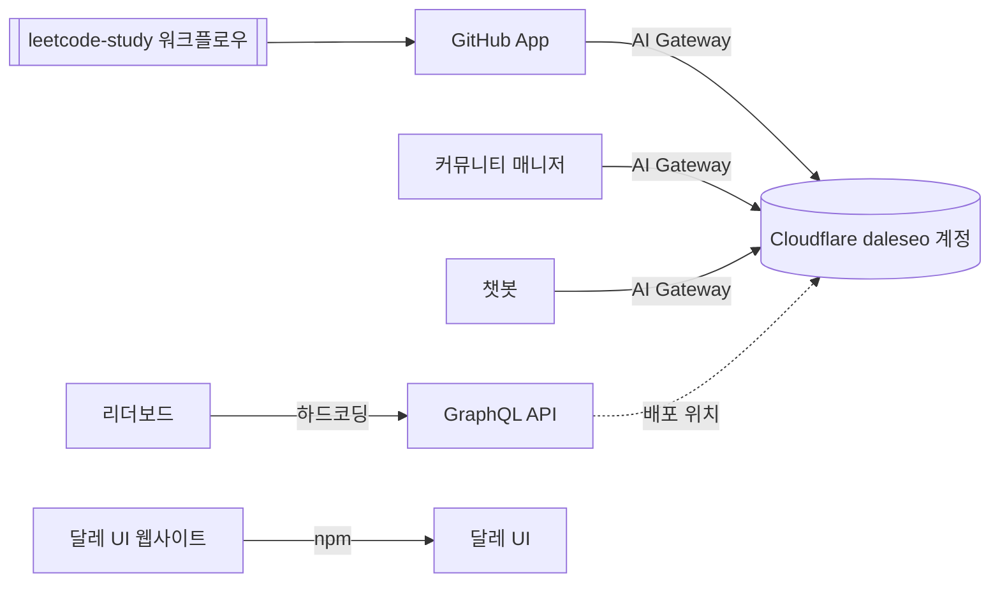

# 배포 지도

달레 스터디 서비스가 어디에 어떻게 배포되는지 정리한 문서입니다.

마지막 확인: 2026-10-11

## 서비스

| 서비스 | 저장소 | 주소 | 호스팅 | 배포 |
| --- | --- | --- | --- | --- |
| 웹사이트 | [dalestudy.com](https://github.com/DaleStudy/dalestudy.com) | [dalestudy.com](https://dalestudy.com) | Cloudflare Workers | GitHub Actions |
| 리트코드 스터디 | [homepage](https://github.com/DaleStudy/homepage) | [leetcode.dalestudy.com](https://leetcode.dalestudy.com) | GitHub Pages | 브랜치 배포 |
| 리더보드 | [leaderboard](https://github.com/DaleStudy/leaderboard) | [leaderboard.dalestudy.com](https://leaderboard.dalestudy.com) | GitHub Pages | GitHub Actions |
| 챗봇 | [chat](https://github.com/DaleStudy/chat) | [chat.dalestudy.com](https://chat.dalestudy.com) | Cloudflare Workers | GitHub Actions |
| 스케줄 | [schedule](https://github.com/DaleStudy/schedule) | [schedule.dalestudy.com](https://schedule.dalestudy.com) | Cloudflare Workers | GitHub Actions |
| 커피챗 | [coffee](https://github.com/DaleStudy/coffee) | [coffee.dalestudy.com](https://coffee.dalestudy.com) | Cloudflare Workers | GitHub Actions |
| 피드백 | [feedback](https://github.com/DaleStudy/feedback) | [feedback.dalestudy.com](https://feedback.dalestudy.com) | Cloudflare Workers | GitHub Actions |
| GitHub App | [github](https://github.com/DaleStudy/github) | `github.dalestudy.com` | Cloudflare Workers | GitHub Actions |
| 커뮤니티 매니저 | [community-manager](https://github.com/DaleStudy/community-manager) | `community-manager.dalestudy.workers.dev` | Cloudflare Workers | GitHub Actions |
| GraphQL API | [graphql](https://github.com/DaleStudy/graphql) | `graphql.daleseo.workers.dev` | Cloudflare Containers | GitHub Actions |
| 달레 UI 웹사이트 | [daleui.com](https://github.com/DaleStudy/daleui.com) | [www.daleui.com](https://www.daleui.com) | Cloudflare Workers | GitHub Actions |
| 달레 UI | [daleui](https://github.com/DaleStudy/daleui) | npm, Chromatic | npm, Chromatic | GitHub Actions |
| 에이전트 스킬 | [skills](https://github.com/DaleStudy/skills) | [skills.sh](https://www.skills.sh/dalestudy/skills) | skills.sh | - |

표에 없는 저장소(`.github`, `DaleStudy`, `book-study`, `leetcode-study`, `ai-study`, `english-interview`, `blog-study`, `coffee-chat`, `hackathon-blog`)는 배포하지 않습니다.

## 배포 방식

Cloudflare Workers 서비스는 모두 GitHub Actions로 배포합니다. `main`에 머지되면 저장소의 `deploy.yml`이 `wrangler deploy`를 실행하고, Workers Builds는 쓰지 않습니다.

- **시크릿:** Worker 시크릿의 원본은 GitHub 시크릿입니다. 배포할 때마다 Worker로 넣으므로 Cloudflare 대시보드나 `wrangler secret put`으로 따로 고치지 않습니다.
- **PR 미리보기:** 웹사이트·스케줄·커피챗은 공유 워크플로우 [`DaleStudy/.github`의 `workers-preview.yml`](https://github.com/DaleStudy/.github/blob/main/.github/workflows/workers-preview.yml)로 Workers Previews(`wrangler preview`)를 띄워 `https://pr-<번호>-<worker>.dalestudy.workers.dev` 주소를 PR에 남기고, PR이 닫히면 지웁니다. 미리보기 설정은 저장소 `wrangler.jsonc`의 `previews` 블록을 따릅니다. 피드백은 운영 설문 데이터를 지키려고 미리보기 전용 D1을 쓰고, `https://pr-<번호>.feedback-preview.dalestudy.com`에 띄웁니다.

| GitHub 조직 시크릿 | 용도 | 쓰는 저장소 |
| --- | --- | --- |
| `CLOUDFLARE_API_TOKEN` | `dalestudy` 계정 Workers 배포 (D1 포함) | chat, coffee, community-manager, dalestudy.com, daleui.com, feedback, github, schedule |
| `AI_GATEWAY_TOKEN` | `daleseo` 계정 AI Gateway | chat, community-manager, github |
| `APP_PRIVATE_KEY` | GitHub App(dalestudy) private key | community-manager, github |
| `APP_CLIENT_SECRET` | GitHub App(dalestudy) 로그인 | feedback |

## 의존 관계

- 리더보드는 GraphQL API를 사용합니다. 주소가 `src/api/infra/gitHub/gitHubClient.ts`에 하드코딩되어 있습니다.
- `leetcode-study`의 워크플로우가 GitHub App을 호출합니다.
- GitHub App, 커뮤니티 매니저, 챗봇은 `daleseo` 계정의 AI Gateway를 사용합니다.

## 계정

| 계정 | 서비스 | 소유자 |
| --- | --- | --- |
| Cloudflare `dalestudy` (`dalestudy.workers.dev`) | GraphQL API를 제외한 Cloudflare 서비스 | admin@dalestudy.com |
| Cloudflare `daleseo` (`daleseo.workers.dev`) | GraphQL API, AI Gateway | DaleSeo (개인 계정) |
| GitHub Pages | 리트코드 스터디, 리더보드 | DaleStudy org |
